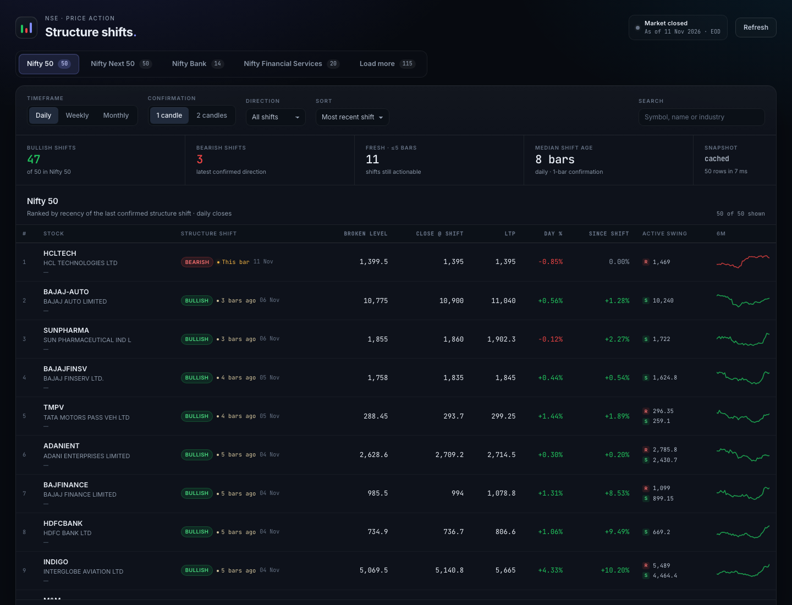
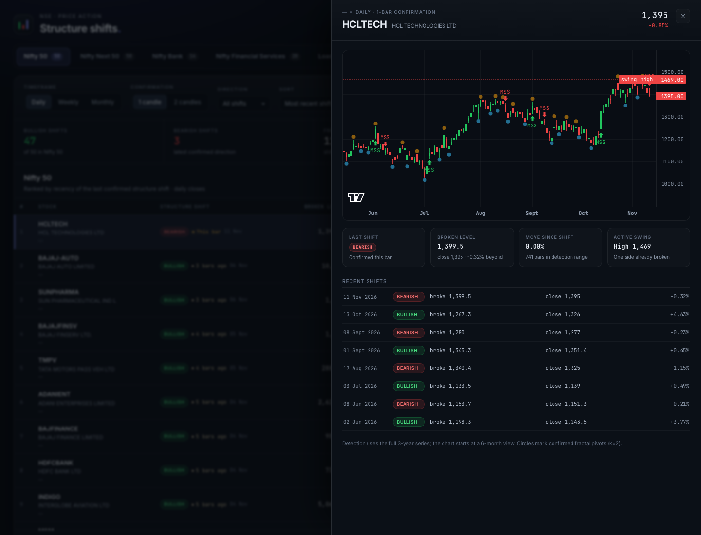

# MSS Dashboard

NSE index dashboard ranked by **how recently each stock's market structure shifted**.
Price action only: confirmed fractal swings, a close beyond the swing, and a
one- or two-candle confirmation rule.





- **Indices:** the full NSE catalogue. The first four entries are primary tabs;
  the rest load on demand behind **Load more**. Nothing is packaged with the app.
- **Timeframes:** Daily (default), Weekly, Monthly
- **History:** 3 years used for detection, 6 months shown on the chart
- **Adjustments:** split/bonus adjustments are not modelled; demerger-affected
  symbols are excluded from the backtest
- **Compute:** aggregation, pivots, MSS and ranking run in a Web Worker
- **Backtest:** runtime A/B of fractal k=2 vs ATR(14, 2×) MSS setups, on demand,
  for the selected stock and two aggregate scopes

## Quick start

Requires Node 20+ (global `fetch`).

```bash
npm install
npm run backfill   # catalogue + first 4 memberships + 110 symbols, about 4 s
npm run dev        # http://127.0.0.1:5173
```

Open `http://127.0.0.1:5173/?debug=1` to see the load-time overlay.
The core snapshot is written to `public/data/snapshot.json` (gitignored).
Runtime caches (catalogue, scripcodes, lazy indices) are written under
`data/cache/` (also gitignored). The dev server exposes `/api/*`, so **Load
more** works locally without Vercel or Blob.

```bash
npm run test:mss   # pivot / MSS / aggregation checks
npm run typecheck
npm run build
```

## How data is fetched

Everything is API-backed. The index catalogue and memberships come from NSE's
index tracker API; daily bars come from the undocumented charting API. Both are
called server-side only.

```
GET /api/NextApi/apiClient/indexTrackerApi?functionName=getAllIndices
  -> { data: { "NIFTY 50": { indicesLongName, indicesShortName, ... }, ... } }

GET /api/NextApi/apiClient/indexTrackerApi
  ?functionName=getConstituents&index=NIFTY%2050&noofrecords=0
  -> { data: [{ cmSymbol: "HDFCBANK", weightage, ... }] }
```

`getAllIndices` currently returns **119 indices** in display order. The first
four become the primary tabs: Nifty 50, Nifty Next 50, Nifty Bank and Nifty
Financial Services (110-symbol union). Every other index is a lazy dataset:
selecting it calls `/api/index?key=...`, which reuses bars already in the core
snapshot and fetches only the missing symbols. The result is cached in Blob and
IndexedDB against the core snapshot version.

Charting calls:

```
GET /v1/exchanges/symbolsDynamic?symbol=RELIANCE-EQ
  -> { symbol, scripcode: "2885", type: "Equity" }

GET /v1/charts/symbolHistoricalData
  ?token=2885                 # the scripcode, NOT a session token
  &symbol=RELIANCE-EQ
  &symbolType=Equity
  &fromDate=<unix seconds>
  &toDate=<unix seconds>
  &chartType=D&timeInterval=1
  -> { data: [{ time: <ms>, open, high, low, close, volume }] }
```

Three traps are encoded in `src/lib/sources/charting.ts`:

1. **The token is the scripcode.** `token=3426` belongs to TATAPOWER; passing a
   different `symbol` silently returns TATAPOWER's series. Always resolve the
   ticker first and cache the map in `data/cache/scripcodes.json` (or
   `state/scripcodes.json` in Blob on Vercel).
2. **Never send an `Origin` header.** NSE answers
   `500 {"error":"Not allowd by CORS"}`. Browser-direct calls are impossible;
   backfill and refresh run server-side.
3. **Send a browser-like `User-Agent` and `Referer: https://www.nseindia.com/`.**

The full 110-symbol core build takes about **3.8 seconds at 8 workers**, plus
~0.5 s for the catalogue and memberships. `npm run backfill` fails if coverage
drops below 95% unless `--allow-partial` is passed.

Three recent listings have less than three years of data — VAML (104 bars), TMCV
(248), TATACAP (268). Anything below 30 bars in the selected timeframe is
labelled **insufficient** instead of being ranked.

## Methodology

### Bars

Daily bars are used as delivered. Weekly bars are Monday-based buckets; monthly
bars are calendar months. A bucket is dated by its **last actual trading day**,
not a synthetic period end.

### Fractal pivots

A pivot high at index `i` is strictly higher than the `k=2` bars on each side; a
pivot low is strictly lower. A pivot is only **confirmed at `i + k`**, and the
MSS engine only sees it from that bar onward. This is what prevents look-ahead:
a swing that is obvious in hindsight was not tradable knowledge at the time.

### Structure shift

The engine tracks the latest confirmed swing high and swing low.

- A close **above** the latest confirmed swing high is a bullish shift.
- A close **below** the latest confirmed swing low is a bearish shift.
- After a shift, the broken side is cleared and repopulated by later pivots.
- Wicks alone never count. Only closes do.

**Confirmation 1** (default) acts on the close of the breaking bar.
**Confirmation 2** requires two consecutive closes beyond a level that was
already confirmed on the first close. That makes the event date, and therefore
the recency ranking, one bar later by construction.

### Ranking

Rows are sorted by `barsSince` ascending (the last confirmed shift first).
Ties break by symbol. The table also supports sorting by symbol, day change,
move since the shift, and LTP. `barsSince` counts the live/provisional bar when
the market is open.

### Backtest

The **Backtest** button opens a runtime A/B. It never runs automatically:
choose an index, choose a stock, then press **Run**. Changing the index or the
stock clears the previous result.

Two complete setups share the same entry rule:

| | Fractal setup | ATR setup |
|---|---|---|
| Pivots | strict fractal `k=2` | ATR(14) zigzag, `2 × ATR` |
| Entry | next open after an MSS flip | next open after an MSS flip |
| Stop | last confirmed fractal swing | last confirmed ATR swing |
| Target | `2R` from the actual entry | `2R` from the actual entry |

Rules:

- Finalized daily bars only; today's forming bar is excluded when provisional.
- One-candle MSS confirmation.
- The stop is frozen at the flip (`stopLevel` on the event). A swing confirmed
  later is never used.
- If no opposite swing is active at the flip, or the entry open is already
  beyond the stop, the signal is skipped and counted.
- An opposite MSS flip exits at the next open; the reverse trade opens at the
  same open.
- A same-bar stop and target is marked **ambiguous** and excluded from the
  headline win rate. The UI reports lower and upper bounds.
- A position still open at the end is reported as **open** and excluded from
  W/L.
- Longs and shorts are aggregated.
- Costs are off by default and can be set per side under **Advanced**.
- `SIEMENS`, `TMPV` and `VEDL` are excluded everywhere: their raw series contain
  demerger gaps that would fabricate flips, stops and targets.

Scopes, computed in one Run:

1. **Selected stock**
2. **Selected index** — the members of the chosen primary index
3. **All core** — the union of the four primary indices, 107 symbols after the
   exclusions

Metrics include win rate, realized breakeven win rate, average win and loss in
R, expectancy, profit factor, max drawdown, exit-reason counts, ambiguous/open/
skipped counts, average stop distance, average holding bars, and average
favorable/adverse excursion (MFE/MAE). Two diagnostics summarise whether trades
ever worked: losses that never reached +0.5R of profit, and wins that first drew
down at least 0.5R. The equity curve uses a shared date axis.

The full trade list is shown for the selected stock. Each row has a **Chart**
action that opens the stock's drawer with the trade drawn on the daily bars:
entry, frozen stop, 2R target, exit marker, MFE/MAE, and the reason in words.
Use ← / → to step through that setup, or the **Fractal / ATR** chips to jump to
the nearest trade in the other setup, so the two stops can be compared on the
same price path. The drawer's trade toggle can also show every entry and exit
for one setup without focusing a single trade.

The cross-stock result is the statistically useful one; a single stock has too
few flips for the A/B difference to be reliable. Survivorship bias applies
because memberships are current-only.

### Provisional bars

The charting API includes today's bar. While the market is open, today's bar is
excluded from confirmation and labelled **live**; LTP and day change still use
it. After 15:30 IST it counts normally.

### Row fields

| Field | Meaning |
|---|---|
| Structure shift | Direction and age of the last confirmed shift |
| Broken level | The swing high/low that failed |
| Close @ shift | Close of the confirming bar |
| Since shift | Move from that close to LTP |
| R / S | Nearest unbroken confirmed swing high / low |
| 6M | Last 40 daily closes (26 weekly, 12 monthly) |

## Snapshot contract

```ts
type IndexInfo = {
  key: string;              // NSE API key, e.g. "NIFTY 50"
  slug: string;             // "nifty-50"
  name: string;             // long display name
  short: string;
  description: string;
  fno?: string | null;      // F&O index name when present
};

type Snapshot = {
  version: string;          // "<asOf>.<generatedAt stamp>"
  asOf: string;             // latest trading date
  generatedAt: string;      // ISO timestamp
  source: 'nse-charting' | 'bhavcopy';
  historyFrom: string;      // earliest requested date, reused by lazy loads
  catalogue: IndexInfo[];   // every index from getAllIndices, in API order
  indices: (IndexInfo & { symbols: string[] })[]; // first four, with members
  symbols: Record<string, {
    name: string;
    industry: string;
    scripcode: string;
    type: 'Equity' | 'Index';
    bars: [date, open, high, low, close, volume][]; // 3Y daily, raw OHLCV
    listedFrom?: string;
  }>;
};

// GET /api/index?key=NIFTY%20MIDCAP%20100
type IndexDataset = {
  version: string;          // must match the core snapshot
  asOf: string;
  index: IndexInfo & { symbols: string[] };
  data: Record<string, SnapshotSymbol>; // only symbols missing from core
};
```

The snapshot stores the **raw OHLCV** returned by the charting API; no
corporate-action adjustment layer is applied. Splits, bonuses and demergers can
therefore appear as gaps. The backtest excludes the three known demerger-affected
symbols and warns when a selected stock moves more than 25% close-to-close. A
future bhavcopy adapter can add an adjustment layer without changing the
contract.

## Performance and load time

We are deliberately **not optimizing before measuring**. The dashboard records
client marks and the refresh function logs per-phase timings. Budgets below are
provisional until more real runs exist.

### Budgets

| Metric | Target | Status |
|---|---|---|
| Cached first table | ≤ 800 ms | met locally (110–131 ms) |
| Cold first table, 25 Mbps | ≤ 3 s | not yet measured over network |
| Snapshot transfer | ≤ 1 MB gzip | **missed** (1.40 MB) |
| Timeframe toggle | ≤ 150 ms | met (8–16 ms) |
| Confirmation toggle | ≤ 50 ms | met (~11 ms) |
| `/api/version` warm | ≤ 300 ms | not yet deployed |
| Full candle refresh | ≤ 15 s | local core build 3.8 s; serverless TBD |
| Worker compute, 50 symbols | ≤ 200 ms | met (7–18 ms) |
| Lazy index, first load | ≤ 5 s | met (2.9 s for 90 new symbols) |
| Lazy index, cached | ≤ 500 ms | met (188 ms) |

### Observed runs

| Date | Env | Cache | Snapshot gzip | First table | Compute D/W/M | Backfill | Notes |
|---|---|---|---|---|---|---|---|
| 2026-11-11 | local dev, Chrome, M-series | cleared | 1.40 MB | 110–131 ms | 8.5 / 16.4 / 12.1 ms | 4.4 s total | 119 indices, 4 primary, 110/110 symbols, 3.77 MB raw; local file served by Vite |
| 2026-11-11 | local dev, Chrome, M-series | warm | 1.40 MB | 188 ms (after lazy attach) | day 16 ms | — | Nifty Midcap 100: 90 new symbols in 2.86 s, compute 111 ms |

Breakdown of the cold run: cache read 10–15 ms, snapshot fetch 27–37 ms,
worker init 58–63 ms, first compute 18 ms. The snapshot-fetch number is a local
file read and is **not** representative of a cold CDN download.

Lazy loading is measured from click to the table switching index:
`app:index-load:<slug>`. The first selection of Nifty Midcap 100 fetched 90
symbols in 2.86 s; a reload with the dataset cached in Blob and IndexedDB took
188 ms. `/api/index` logs requested/reused/fetched/failed and fetch time.

### How to measure

- `?debug=1` shows every mark in a bottom-right overlay.
- Marks: `app:cache-read`, `app:snapshot-fetch`, `app:worker-init`,
  `app:compute:<tf>:<conf>`, `app:first-table`, `app:version-check`,
  `app:index-load:<slug>`, `app:refresh-apply`.
- `/api/refresh` logs one JSON line per rebuild with coverage, fetch time, write
  time, total time and payload bytes.
- Record each meaningful run in the table above.

### Known follow-ups

The core snapshot missed its transfer budget. Dropping `volume`, which the UI
does not use, previously took a 105-symbol payload from 1.34 MB to **0.98 MB
gzipped**; the same fix now applies to the 110-symbol core. The rest, including
lazy-index cost, is tracked in [`docs/enhancements.md`](docs/enhancements.md).

## Deploying to Vercel

1. Create a Vercel project and a Blob store; set `BLOB_READ_WRITE_TOKEN`.
2. Set `CRON_SECRET` (locks `/api/refresh`; Vercel Cron sends it automatically).
3. Build the first snapshot locally and publish it:

   ```bash
   npm run backfill
   BLOB_READ_WRITE_TOKEN=... npm run publish:snapshot
   ```

4. Set `VITE_SNAPSHOT_URL` to the printed snapshot URL and deploy.
5. `vercel.json` schedules `GET /api/refresh` at `13:45 UTC` (19:15 IST),
   Monday–Friday.

The client uses `VITE_SNAPSHOT_URL` in production and `/data/snapshot.json` in
local dev. On load it renders the IndexedDB copy, fetches the current snapshot,
and calls `/api/version`; a newer version is downloaded in the background. The
manual **Refresh** button triggers a full rebuild through `/api/refresh`.

Server endpoints:

| Route | Purpose |
|---|---|
| `GET /api/version` | Cheap freshness probe |
| `GET /api/indices` | Full catalogue (`getAllIndices`), cached in Blob |
| `GET /api/index?key=...` | Lazy index dataset; reuses core bars |
| `GET/POST /api/refresh` | Rebuild core snapshot and publish to Blob |

`npm run publish:snapshot` also uploads the local catalogue and scripcode cache
to `state/` so the first serverless lazy load does not have to re-resolve every
ticker. Lazy datasets are cached at `snapshots/indexes/<slug>.json` and stamped
with the core snapshot version.

If NSE blocks Vercel's datacenter IPs, run the same `backfill` +
`publish:snapshot` pair from a GitHub Action and leave the app unchanged.

## Project layout

```
api/                    version, catalogue, lazy index, refresh functions
data/cache/             local runtime caches (gitignored, no packaged data)
docs/                   screenshots, enhancement backlog
public/data/            generated core snapshot (gitignored)
scripts/                backfill, publish, MSS tests
src/lib/                types, date, aggregate, pivots, mss, swings,
                        backtest, rank, NSE adapters, builders, cache,
                        storage, api
src/lib/server/         file/Blob storage, catalogue and state helpers
src/workers/            aggregation + MSS worker with lazy datasets and backtest
src/components/         table, sparkline, chart drawer, backtest panel,
                        perf overlay
src/App.tsx             state, orchestration, controls
```

## Limitations

- The charting endpoint is **undocumented** and may change or block without
  notice. Bhavcopy remains the insurance policy.
- Constituents are current-only; historical membership and survivorship bias
  are not modelled.
- Data is end-of-day. Intraday bars are provisional and never confirm structure.
- Corporate-action adjustment is not modelled. Demerger gaps are detected, and
  `SIEMENS`, `TMPV` and `VEDL` are excluded from the backtest; a large gap in a
  selected stock is shown as a warning.
- Daily bars cannot reveal whether the stop or the target traded first. Those
  trades are marked ambiguous instead of guessed.
- Cash-market overnight shorts are not directly executable by retail investors;
  the backtest aggregates them with longs.
- Recent listings cannot be ranked until enough bars exist.
- NSE rebalances are picked up on the next core refresh. Lazy datasets are
  versioned with the core snapshot, so stale memberships are discarded rather
  than mixed.
- The first selection of a large lazy index is slower than a primary tab,
  because its missing symbols are fetched on demand.
- No authentication; the dashboard is public and read-only.

## Roadmap

Bhavcopy incremental ingestion is intentionally **not built yet**. When it is
requested, the design is: fetch one bhavcopy file per missing session, detect
corporate actions by comparing `prev_close` with the stored last close, refetch
the affected symbol from the charting API on an ex-date, and reconcile weekly.
The snapshot contract does not change.

## Attribution

Charts use [lightweight-charts](https://github.com/tradingview/lightweight-charts)
(Apache 2.0). NSE data is used for personal research. This is not investment
advice.
